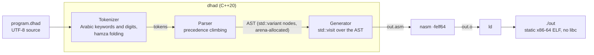

# DhadLang

DhadLang is a compiler for a small programming language with Arabic keywords. It is written in C++20 with no dependencies. `dhad` turns a `.dhad` file into x86-64 NASM assembly, then assembles and links it into a static Linux executable without LLVM or libc. The example below becomes a 5 KB binary.

The name comes from the letter ض (ḍād). Arabic is often called *lughat al-ḍād*, "the language of the ḍād".

## Example

<div dir="rtl">

```text
# مجموع الأعداد الفردية الأقل من ١٠
دالة فردي(ن) {
    ارجع ن % 2 == 1;
}

دع مجموع = 0;
دع ع = 0;
بينما (ع < 10) {
    اذا (فردي(ع)) {
        مجموع = مجموع + ع;
    }
    ع = ع + 1;
}
اطبع(مجموع);   # 25
```

</div>

The same program, word for word in English (for reading only; the compiler accepts the Arabic keywords):

```text
# sum of the odd numbers below 10
func odd(n) {
    return n % 2 == 1;
}

let sum = 0;
let i = 0;
while (i < 10) {
    if (odd(i)) {
        sum = sum + i;
    }
    i = i + 1;
}
print(sum);   # 25
```

This program is `tests/example_0.dhad`, so the test suite checks it.

## Build and run

On Linux x86-64 with g++ (C++20, GCC 10 or later), make, nasm and ld:

```bash
make                          # builds ./dhad
./dhad tests/example_0.dhad   # writes out.asm, out.o and the executable ./out
./out                         # prints 25
echo $?                       # exit code
```

Anywhere else, including Apple Silicon Macs, use Docker:

```bash
docker build --platform linux/amd64 -t dhadlang .
docker run --rm --platform linux/amd64 -v "$PWD":/dhad dhadlang \
  sh -c 'make -s && ./dhad tests/example_0.dhad && ./out'
```

## Language

| Keyword | Read as | Meaning |
|---|---|---|
| `دع` | da' | declare a variable |
| `دالة` | dalla | declare a function (top level, before its first call) |
| `ارجع` | irji' | return; a function that ends without one returns 0 |
| `اذا` | idha | if |
| `واذا` | wa-idha | else if |
| `والا` | wa-illa | else |
| `بينما` | baynama | while |
| `توقف` | tawaqqaf | break |
| `استمر` | istamirr | continue |
| `اطبع(x)` | itba' | print x and a newline |
| `خروج(x)` | khuruj | exit with code x |

- Operators: `+ - * / %`, `== != < > <= >=`, `&&` and `||` (short-circuit), unary `-` and `!`.
- Every value is a 64-bit signed integer.
- `#` starts a comment that runs to the end of the line.
- Numbers use ASCII or Arabic-Indic digits (`٠١٢٣٤٥٦٧٨٩`).
- The Arabic comma `،` and semicolon `؛` work like `,` and `;`.
- Keywords accept hamza spellings: `إذا` works like `اذا`, and `وإلا` like `والا`.
- Compile errors name the line, for example `line 3: Expected ';'`.

## How it works



The generator is a stack machine: each expression pushes its result, and each operator pops its operands. Every function, and `_start`, gets an rbp frame:

```text
inside add(a, b), called as add(3, 4)            the stack grows down
[rbp + 24]  a = 3          first argument (the caller pushes left to right)
[rbp + 16]  b = 4          last argument
[rbp +  8]  return address
[rbp +  0]  caller's rbp   <- rbp
[rbp -  8]  1st local      a local keeps its slot for its whole scope
[rbp - 16]  2nd local
   ...      temporaries    pushed and popped while evaluating expressions   <- rsp
```

Globals live in `.bss`. Functions return their result in `rax`, and the caller pops the arguments.

### Generated code

This function doubles its argument:

<div dir="rtl">

```text
دالة ضعف(ن) {
    ارجع ن * 2;
}

اطبع(ضعف(21));
```

</div>

`dhad` emits this (the `.bss` section and the print routine are left out):

```nasm
funclabel0:                 ; double(n)
   push rbp
   mov rbp, rsp
   push QWORD [rbp + 16]    ; n
   mov rax, 2
   push rax
   pop rbx
   pop rax
   imul rax, rbx
   push rax
   pop rax                  ; return value in rax
   mov rsp, rbp
   pop rbp
   ret
   mov rax, 0               ; implicit "return 0", unreachable here
   mov rsp, rbp
   pop rbp
   ret

_start:
   mov rbp, rsp
   mov rax, 21
   push rax
   call funclabel0
   add rsp, 8               ; caller pops the argument
   push rax
   pop rax
   call dhad_print
   mov rax, 60              ; exit(0)
   mov rdi, 0
   syscall
```

Routing every value through the stack keeps the generator short and easy to check, but the output is slow. A peephole pass would remove the `push rax` / `pop rax` pairs and the unreachable return.

## Design decisions

- **UTF-32 internally.** The source is decoded to `std::u32string`, so each Arabic letter is one code unit and the tokenizer never splits a character.
- **ASCII labels only.** Functions and globals get generated labels (`funclabel0`, `_g_label3`), so Arabic identifiers never reach NASM.
- **Keywords are normalized, identifiers are not.** أ, إ and آ fold to ا only for keyword lookup, so `إذا` is `اذا` but two variables that differ by a hamza stay distinct.
- **rbp frames instead of rsp offsets.** A local stays at `[rbp - 8k]` however much is pushed after it. `tests/call_locals_7.dhad` guards against the bug this fixed.
- **`break` and `continue` reset the stack.** Each loop records the stack depth at entry, and a jump restores it with `lea rsp, [rbp - 8n]` before leaving.
- **No libc.** `اطبع` calls a short assembly routine that converts the number to decimal and uses the `write` syscall. Exit is syscall 60.
- **Arena allocation.** AST nodes come from a bump allocator, so allocating a node is a pointer increment.

## Limitations

- Integers only: no strings, arrays or floats.
- Single pass: a function must be declared before its first call. Recursion works; mutual recursion does not.
- Functions can only be declared at the top level.
- No shadowing: `دع` cannot reuse a name that an outer scope already declares.
- Identifiers are letters and digits only (no `_`).
- `خروج(x)` keeps only the low 8 bits of x, as every Linux exit code does.
- The output always goes to `out.asm`, `out.o` and `out` in the current directory, and runs only on Linux x86-64.

## Tests

```bash
make unit          # tokenizer and parser unit tests, on any OS
make test          # unit tests plus end-to-end tests, on Linux x86-64
make docker-test   # everything, anywhere with Docker
```

There are three kinds of test:

- **Unit tests** (`tests/unit.cpp`) check the tokenizer and parser on their own. Parser tests print the tree as an S-expression, so `1 + 2 * 3` must parse to `(+ 1 (* 2 3))`.
- **Program tests:** each `tests/name_N.dhad` is compiled and run, and must exit with code `N`. If `tests/name_N.txt` exists, the program's output must match it.
- **Error tests:** each `tests/errors/*.dhad` must fail to compile with the message on its first line, for example `# expect: line 2: Expected ';'`.

GitHub Actions runs all of them on every push and pull request.

## Credits

Inspired by Pixeled's *Creating a Compiler* video series ([orosmatthew/hydrogen-cpp](https://github.com/orosmatthew/hydrogen-cpp)), which taught me how a compiler fits together.
